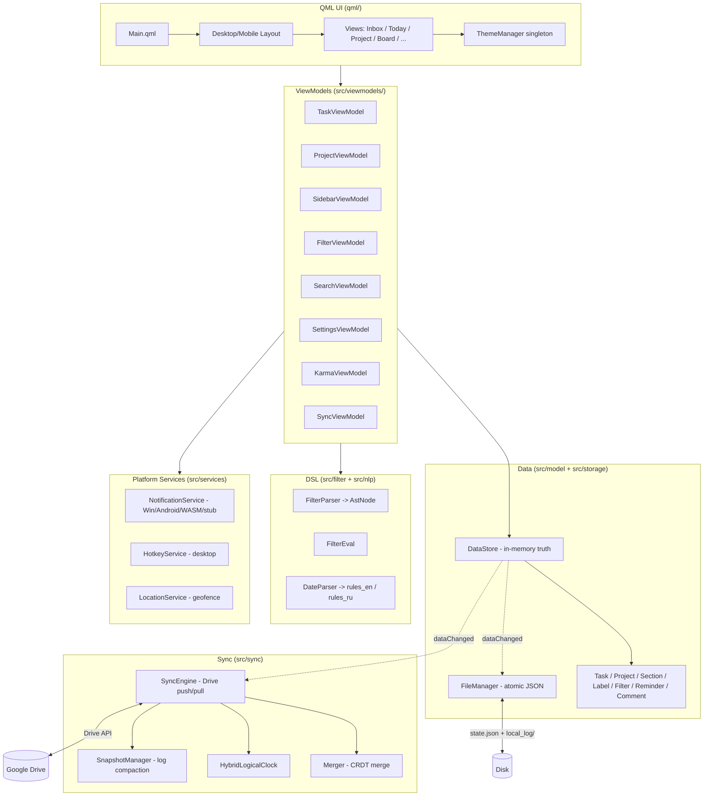
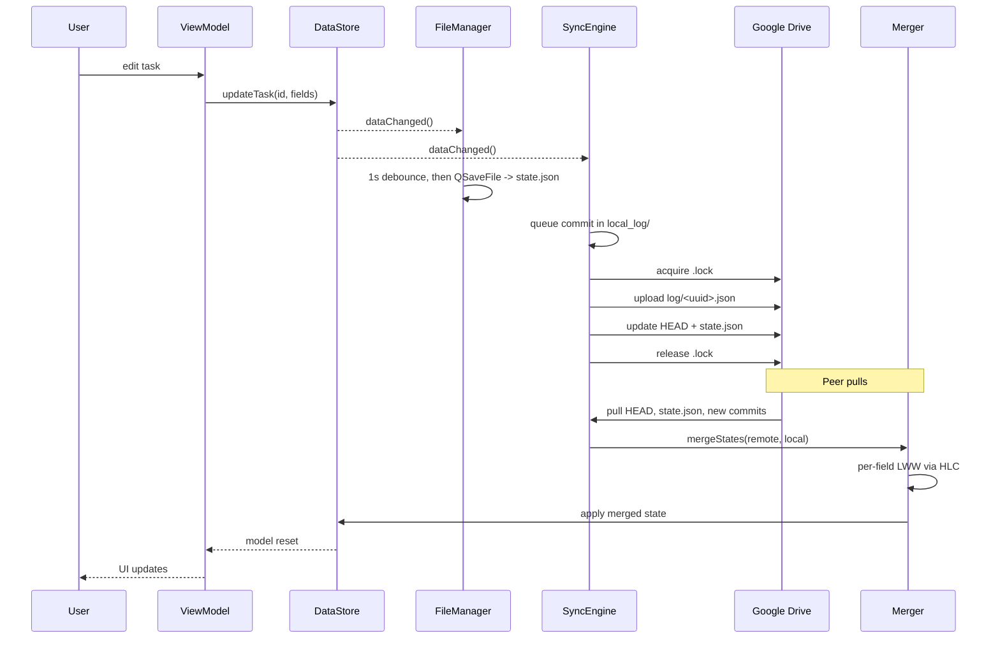

# OpenTodo Architecture

## Overview

OpenTodo is a single-process Qt 6 / QML (C++20) cross-platform task manager targeting Windows, Linux, macOS, Android, and Web (WASM). The application uses a strict layered design where layers communicate exclusively via Qt signals and slots. Almost every C++ type is a `Q_OBJECT` with `Q_PROPERTY` and `Q_INVOKABLE` annotations so QML can consume domain objects directly without bridging glue. Wiring lives in [`src/main.cpp`](../src/main.cpp), which constructs the canonical singletons (`DataStore`, `FileManager`, `SyncEngine`), the platform services, and all ViewModels, then exposes them to QML as `QQmlContext` context properties (`dataStore`, `taskViewModel`, `syncViewModel`, etc.).

## Layer Diagram

## Sync Sequence

## Module Map

- **`src/model/`** — entity classes (`Q_OBJECT`). Every model (Task, Project, Section, Label, Filter, Reminder, Comment) carries a UUID (`utils/uuid.h`), `created_at`, `updated_at`, and a soft-delete tombstone (`is_deleted`). `toJson()` / `fromJson()` round-trip is authoritative for sync and disk.
- **`src/storage/`** — `DataStore` (in-memory source of truth: parallel `QList` + `QMap` index per entity type with per-entity `_meta` CRDT blob) and `FileManager` (debounced 1 s autosave to `state.json` via `QSaveFile`; pending commits under `local_log/`).
- **`src/sync/`** — `SyncEngine` (Google Drive push/pull with `.lock`-coordinated commit log), `Merger` (per-field LWW CRDT merge), `HybridLogicalClock` (HLC stamps for ordering), `CrdtMeta` (OR-Set for ordered collections like `label_ids`), `SnapshotManager` (compacts the commit log every N commits, default 100), plus `GDriveClient` and `OAuthClient`.
- **`src/filter/`** — recursive-descent `FilterParser` producing an `AstNode` tree; `FilterEval` evaluates a tree against a task. Operators: `& | ! ( ) ,` plus predicates `today`, `tomorrow`, `overdue`, `no date`, `p1`–`p4`, `#Project`, `@label`, `/Section`, `search:`, `N days`, `before/after <date>`, `recurring`, `!recurring`, `created before/after`, `assigned`, `completed`.
- **`src/nlp/`** — `DateParser` dispatches on language to `rules_en.cpp` or `rules_ru.cpp` (per-language `DateRuleFunc` pointers). Output is `DateParseResult { date, datetime, isRecurring, recurrenceRule, humanString, valid }`.
- **`src/viewmodels/`** — `Q_OBJECT` bridges between data and QML. Most derive from `QAbstractListModel` and expose a `Roles` enum (canonical example: [`taskviewmodel.h`](../src/viewmodels/taskviewmodel.h)). Cross-VM coordination is established by signal-to-lambda connections in `main.cpp`.
- **`src/services/`** — platform-specific implementations of cross-platform interfaces. Each has `_win` / `_android` / `_wasm` / `_stub` variants chosen via `Q_OS_*` and `EMSCRIPTEN` guards: notifications, global hotkey (desktop only), location (requires `Qt Positioning` / `HAS_POSITIONING`). Additional desktop services include reminder scheduler, undo stack, AI assistant, crash logger, telemetry, task exporter, daily review, pomodoro, and update checker.
- **`qml/`** — UI tree. `Main.qml` sets the Material theme and switches between [`layouts/DesktopLayout.qml`](../qml/layouts/DesktopLayout.qml) and [`layouts/MobileLayout.qml`](../qml/layouts/MobileLayout.qml) through a `Loader` keyed on `Qt.platform.os === "android"`. [`themes/ThemeManager.qml`](../qml/themes/ThemeManager.qml) is a QML singleton (`pragma Singleton`) with eight bundled palettes; UI binds to `ThemeManager.backgroundColor`, `.accentColor`, etc. — never hardcoded colors.

## Build Topology

CMake builds an `OpenTodoApp` static library containing all C++ sources and the QML module, plus an executable target that links the library. The QML module sits on the library target (not the executable) because both `androiddeployqt` and Qt's WASM static-link path resolve module imports through the library's standard QML output directory. The QML module URI is `OpenTodoUI`; the entry point is `engine.loadFromModule("OpenTodoUI", "Main")`. Resources use the Qt 6.5+ layout (`RESOURCE_PREFIX "/qt/qml"`), so `Main.qml` resolves to `qrc:/qt/qml/OpenTodoUI/qml/Main.qml`. Platform-conditional sources in [`CMakeLists.txt`](../CMakeLists.txt):

- **`WIN32`** — `notificationservice_win.cpp`, `hotkeyservice_win.cpp`, links `dwmapi` for dark title bar.
- **`ANDROID`** — `notificationservice_android.cpp` + `hotkeyservice_stub.cpp`; `QT_ANDROID_PACKAGE_SOURCE_DIR=android/` (Java helpers in `android/src/org/opentodo/`).
- **`EMSCRIPTEN`** — `notificationservice_wasm.cpp` + `hotkeyservice_stub.cpp`; link options add `-sINITIAL_MEMORY=64MB -sALLOW_MEMORY_GROWTH=1 -lidbfs.js` (IDBFS for state persistence).

Test suite uses Qt Test + QtQuickTest in [`tests/`](../tests/); run with `ctest --test-dir build/release`.

## CRDT Semantics

Conflict resolution is per-field Last-Writer-Wins (LWW) Register stamped with a Hybrid Logical Clock instead of whole-object LWW. Per-field metadata lives under `entity["_meta"][fieldName] = {ts, dev}`. Two devices editing different fields of the same entity concurrently both win their respective fields. Tombstones (`is_deleted = true`) take precedence over ordinary edits — deletes are never overwritten by older edits; only an explicit restore whose `_meta.is_deleted` stamp is strictly newer than the tombstone's revives the entity. A permanent delete keeps the tombstone with `is_purged = true` so it cannot be resurrected by a peer's copy. Ordered collections such as `label_ids` use an OR-Set ([`crdt_meta.h`](../src/sync/crdt_meta.h)) with add-wins semantics. Settings merge key by key: each changed key is stamped `{ts, dev}` in a top-level `settings_meta` object; unstamped (legacy) keys fall back to remote-wins. Legacy entities written before the CRDT meta system (no `_meta` key) fall back to the original whole-object LWW comparison so old local files remain mergeable.
